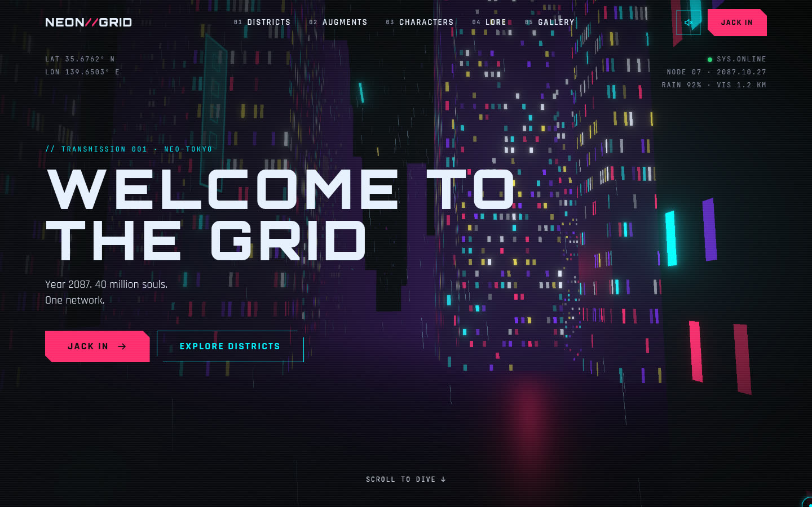
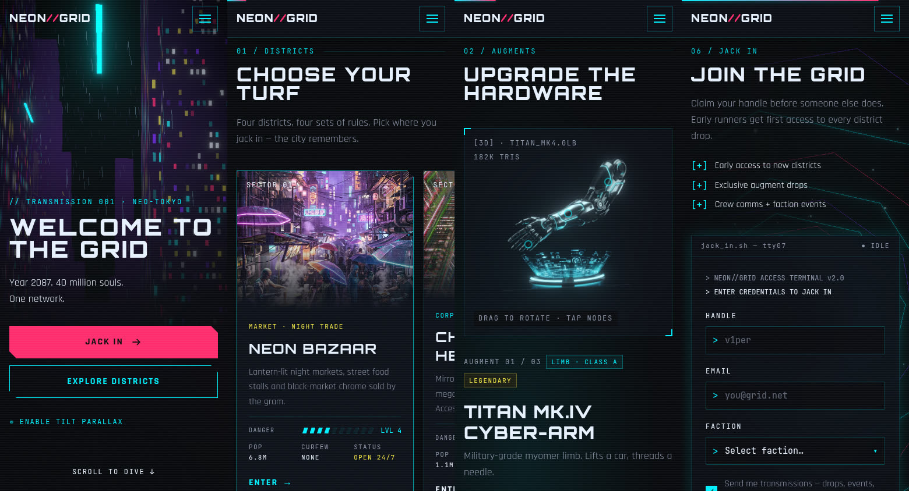
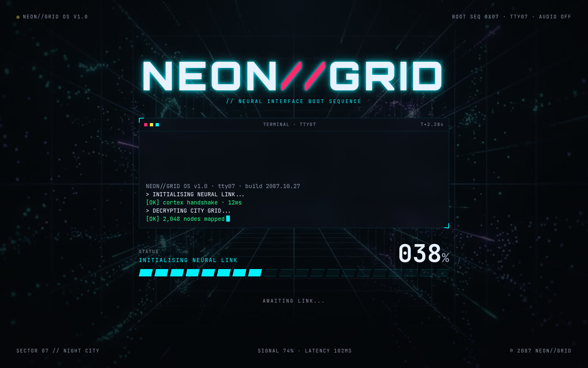
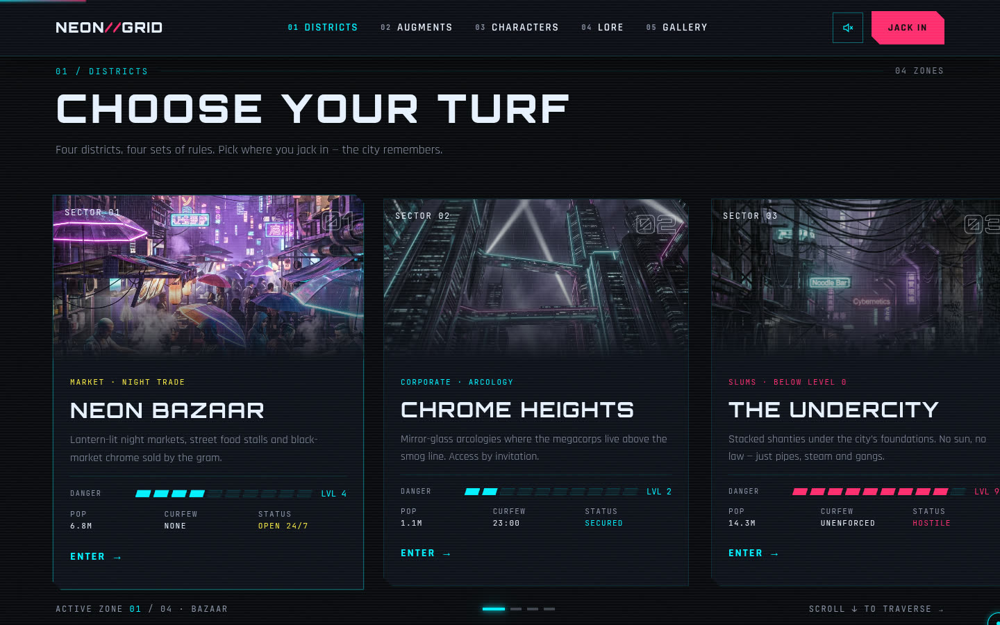
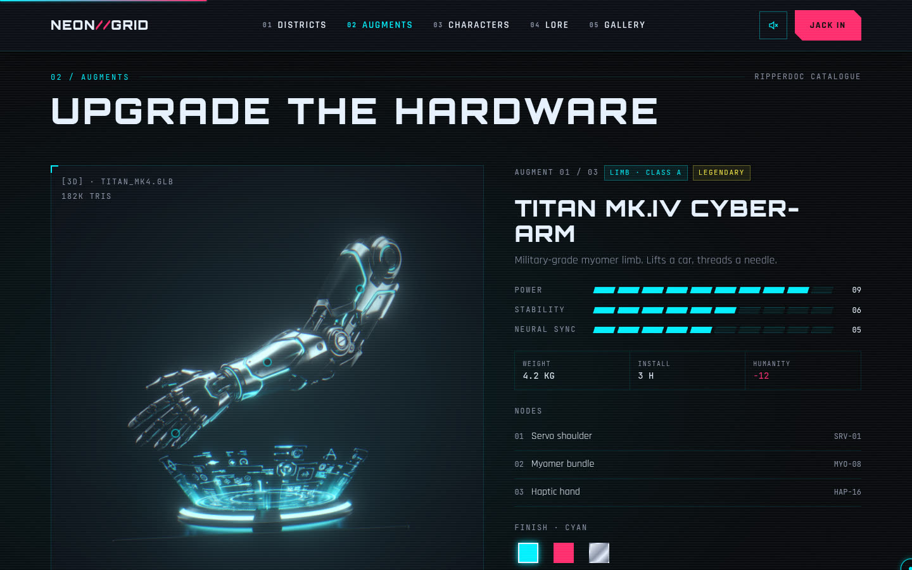
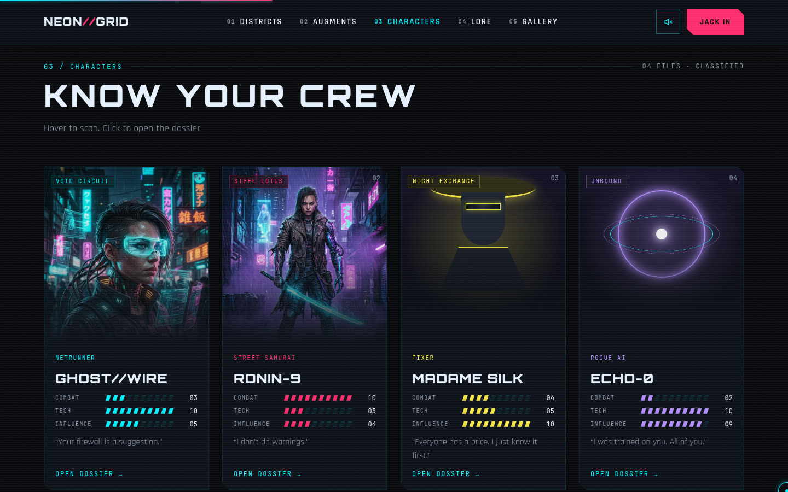
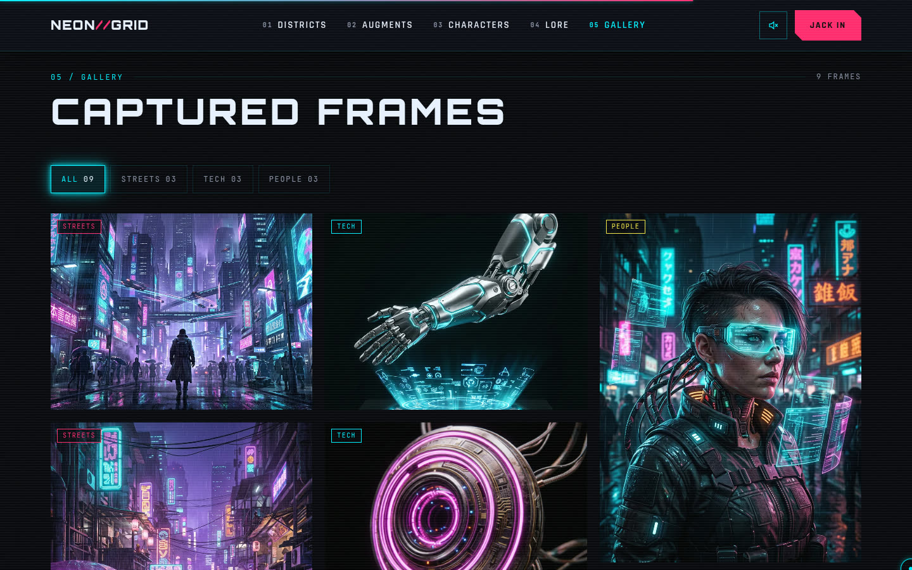
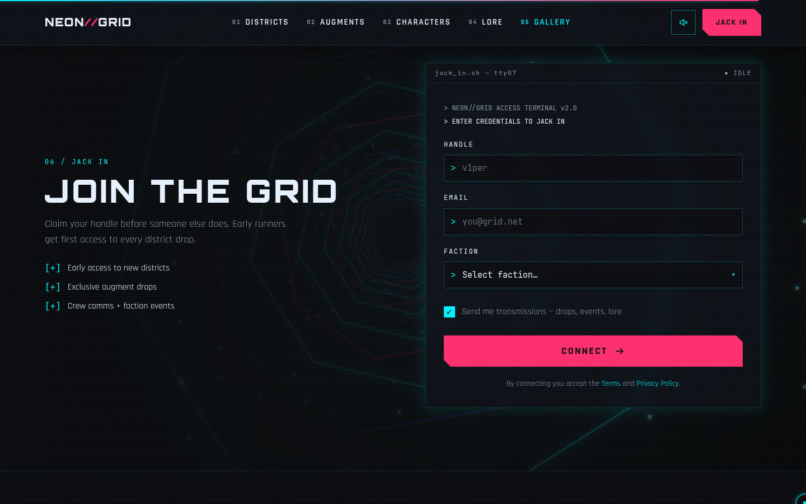

# NEON//GRID

**An immersive 3D cyberpunk landing page, designed as a full design system first and then built to match it.**
Year 2087. 40 million souls. One network.



This repo holds both halves of the project:

| Folder | What it is |
| --- | --- |
| [`NEON-GRID-Design-System/`](NEON-GRID-Design-System) | The design: colour, type, spacing and motion tokens, component sheets, and 72 artboards covering every section on desktop, tablet and mobile, including hover, error, loading and success states. |
| [`neon-grid/`](neon-grid) | The production site: Vite, React 18, TypeScript, Tailwind, Three.js (React Three Fiber), GSAP ScrollTrigger and Lenis. |

## Highlights

- **Boot sequence**: a terminal loader tied to real asset readiness (fonts and the hero 3D scene), with a live signal and latency HUD and an "ENTERING SECTOR 07" hand-off.
- **3D hero**: a procedural rain-soaked city you fly into on scroll, with mouse and gyro parallax and bloom post-processing.
- **Districts**: a pinned horizontal scroll on desktop and a snap carousel on touch. Cards have 10-step danger meters and an RGB-split "signal interference" hover.
- **Augments**: a draggable holographic product viewer with hotspot nodes, finish swatches and an equip state.
- **Characters**: tilt cards, plus dossier modals with bounty records and a threat index.
- **Lore**: a scroll-scrubbed timeline. **Gallery**: a filterable masonry grid with a keyboard and swipe lightbox.
- **Join**: a terminal-style form with Zod validation, a live handle-availability check, loading and success states, and a 3D data tunnel.

## Responsive and accessible

Designed and tested at **390 / 834 / 1440 / 1920 px**, with no horizontal scroll at any width. Every 3D scene loads lazily and pauses off-screen, and falls back to a static image when WebGL, motion or data is limited. Reduced motion is respected throughout, every control is keyboard reachable with a visible focus ring, and an automated axe-core audit reports zero violations on desktop and mobile.



| | |
| --- | --- |
|  |  |
|  |  |
|  |  |

## Run it

```bash
cd neon-grid
npm install
npm run dev      # http://localhost:5173
npm run build    # type check + production build
```

See [`neon-grid/README.md`](neon-grid/README.md) for the project structure and how each requirement is met, and
[`NEON-GRID-Design-System/README.md`](NEON-GRID-Design-System/README.md) for an index of the artboards.

---

Designed and built by [Sahan Induwara](https://github.com/sahan8).
